# UI hill climb (2026-10-28)

A pass over the whole web app to make it less verbose and more consistent. Every station page
was screenshotted on `main` and on this branch, in light and dark, at 1440×900, with the same
dev data (the seeded "Vandale Radio" station). Each image below is before (left) and after
(right). Whole-page shots of every page in both themes were taken; the dark ones shown here are
those where the theme changes something.

## How it went

1. **Baseline.** All 19 pages plus the library's asset panel, light and dark. What stood out:
   - The station name three times at the top of the sidebar, then a flat list of 15 entries.
   - On the calendar, both "Calendrier" and "Émissions" were highlighted.
   - Page headers built by hand on each page: descriptions at 14px on some pages and 16px on
     others, two or three sentences long, back links in three different styles.
   - Text with no size of its own fell back to 16px (alert messages, the show's airings, the
     dashboard), next to 14px everywhere else.
   - In dark mode the primary blue was too dark: today's date in the calendar, the "Semaine"
     toggle and the "En direct" badge were hard to read.
   - The library's asset panel and filter column listed every field, even empty ones.
2. **Round 1: the shell and the theme.** Then every page was checked again.
3. **Round 2: one page header, shorter copy.** Then every page was checked again.
4. **Round 3: the library.** The asset panel and the filter column, then the remaining long texts.

## Choices

### Shell
- **Nav in four groups** (Antenne, Programmation, Contenus, Réglages / On air, Programming,
  Content, Settings), each with its own label, in place of a flat list headed by the station
  name. The groups follow a programmer's day: what's on air, what's planned, the material, the
  settings.
- **One active entry.** The entry whose path is the deepest match for the page is the active
  one, so `/shows/calendar` lights up "Calendrier" only, while `/shows/<id>` still lights up
  "Émissions". This was a bug, not just style.
- **Switcher subtitle:** your role ("Admin") when the org and the station have the same name,
  as Vandale's do, instead of repeating the name.

### Theme
- **Dark `--primary`** raised from `oklch(0.424 …)` to `oklch(0.546 …)` (the light sidebar's
  blue). Text in that colour and filled buttons are now readable on dark grey. White text on the
  button still passes. Recorded in ADR 0009.
- **14px body text** (`text-sm` on `body`). Every component already set 14px or smaller; this
  only changes text that had no size, which was the source of the 16px mix.

### Page header
- **`PageHeader`** (`app/page-header.tsx`) on every page: title (`text-xl`), an optional status
  badge, at most one sentence of description (`text-sm`, muted, `max-w-2xl`), actions on the
  right. **`BackButton`** (ghost, small, aligned with the content's edge) for editors. It lives
  in `app/`, not in `ui/`, because `ui/` holds the generated shadcn components.
- **Descriptions cut to one sentence**, in FR and EN. A description says what the page is;
  how-to text stays where it's needed (e.g. how the relaxation ladder works stays next to the
  ladder, shortened).
- **Removed a duplicate:** the "Calendrier" button on the shows list (it's the nav entry just
  above). It stays on a show's page, where it opens the calendar filtered to that show.
- **Live recording:** the card no longer repeats the page title; the retention hint moved under
  the retention field it describes.
- **Station time notes kept.** The grid's "Hours in station time" note is required (it has a
  test), so it now joins the grid's description instead of sitting on its own line.

### Library ("Médiathèque")
- **Asset panel: only what's set.** Empty values are left out instead of shown as "—". Values
  already in the panel's header (album, year, the explicit badge) aren't repeated. "Modifié" is
  shown only when it differs from "Ajouté". "Normaliser la sonie" is shown only when it's off,
  the exception. Unset cue points are left out (they have no marker on the waveform either).
  File hashes moved to a tooltip. The analyzer version line was dropped.
- **Analysis section** lists only what's still pending, plus BPM, key and energy when they
  exist. For a fully analysed asset that has none of those, the section is hidden.
- **Section headings** are `text-sm font-medium`, like headings everywhere else in the app,
  instead of uppercase.
- **"Éditer les points"** is a small outline button, like "Modifier les tags" next to it. It
  was the only filled primary button in the panel.
- **Filter column.** Status groups (analysis, scheduling window) show only states some asset is
  in. A group left with a single option offers no choice, so it's hidden unless that option is
  checked. "Plus de filtres" (duration, BPM, year, date added, explicit, airplay) is folded and
  opens when you click it; it stays open while one of its filters is set.

### Small fixes
- "1 titres" → "1 titre" (category preview).
- Calendar hint: shorter, and at 12px since it's a hint.

## Before / after

### Shell, nav and dark primary
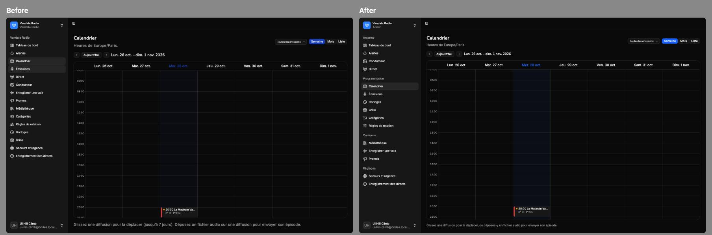
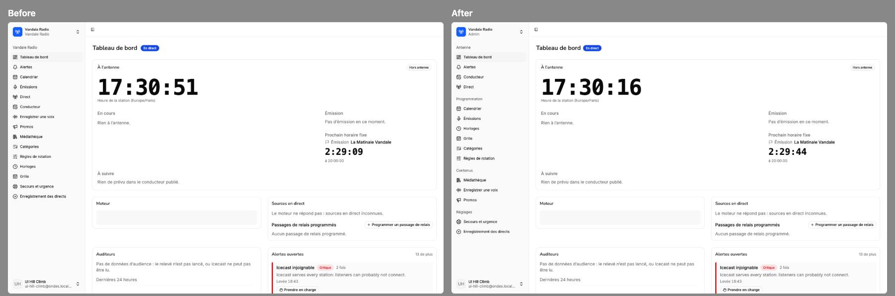
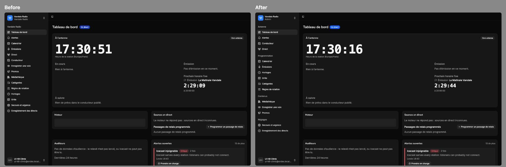

### Page headers and copy
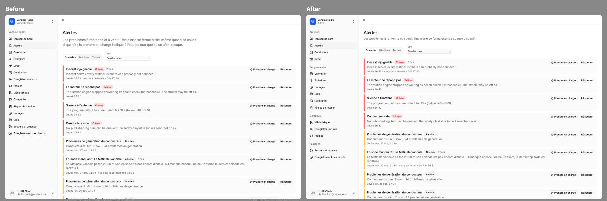
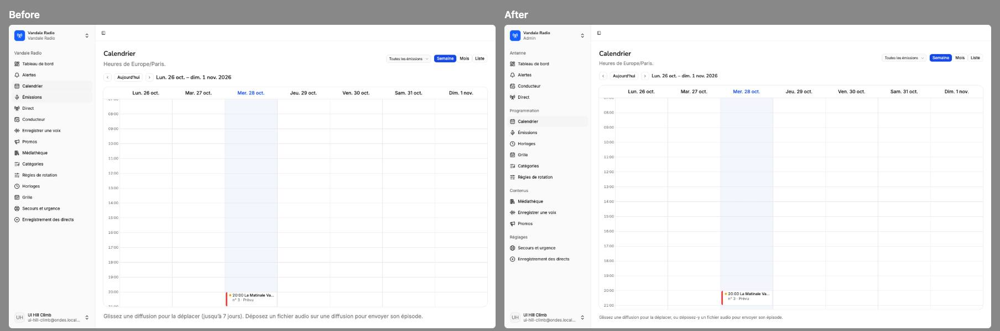
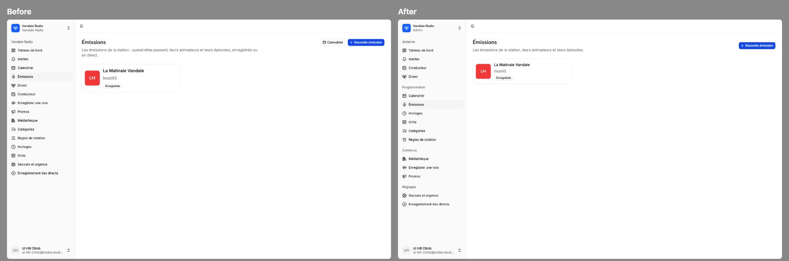
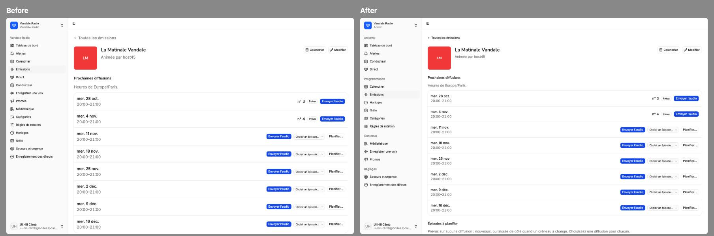
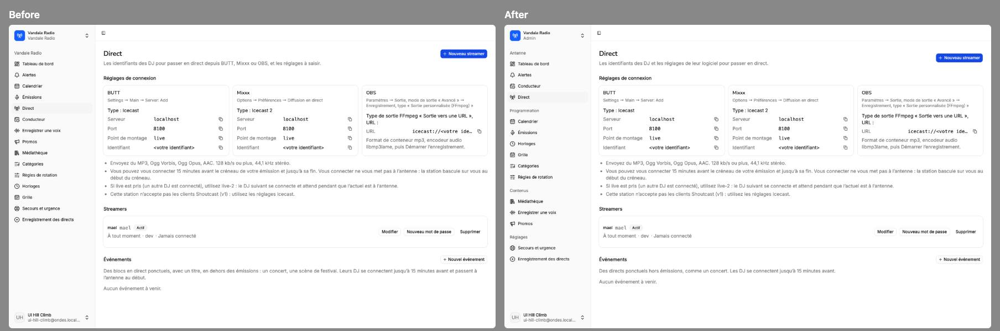
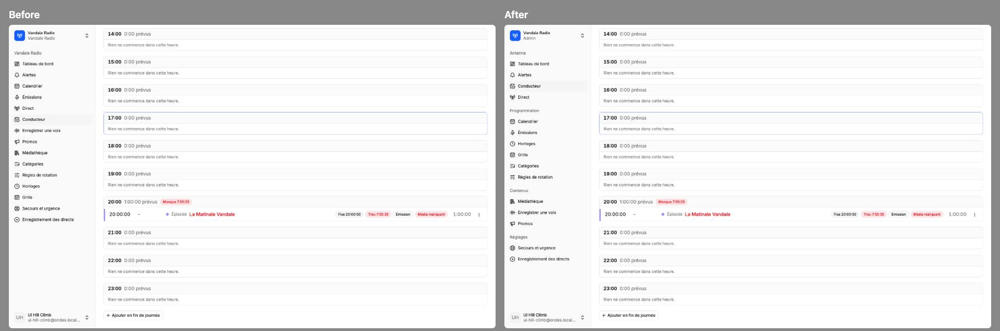
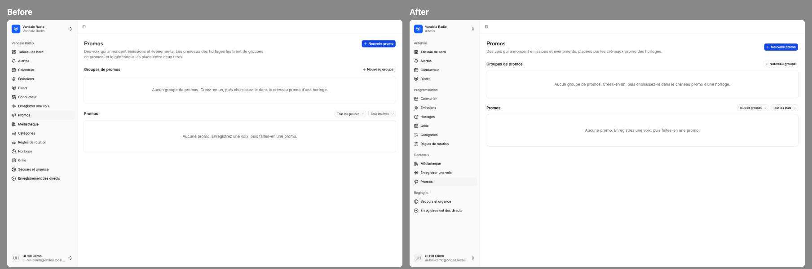
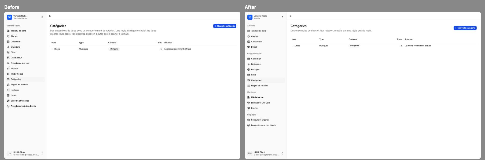
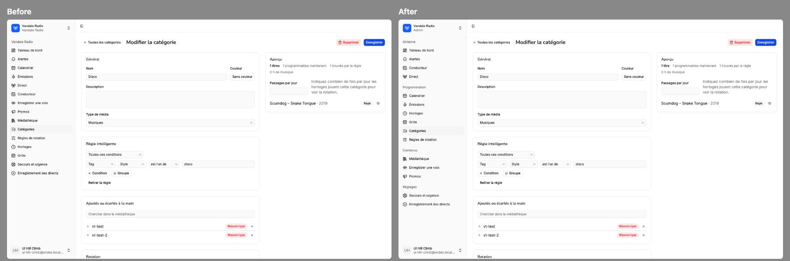
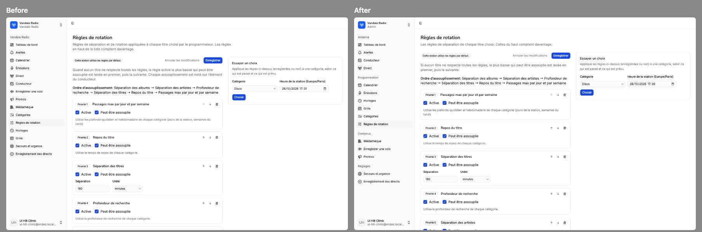
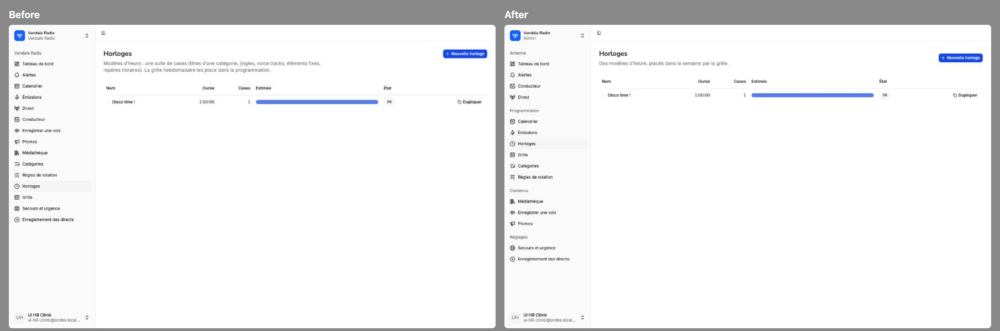
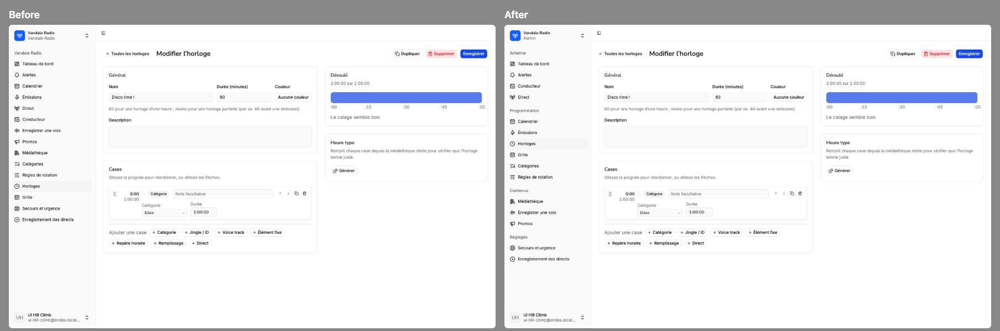
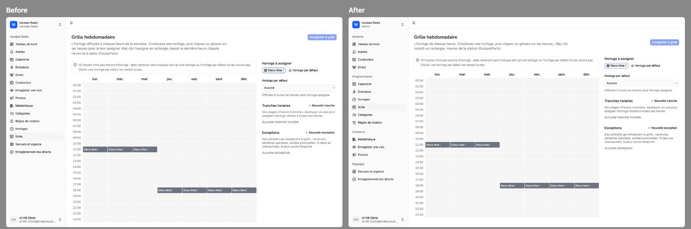
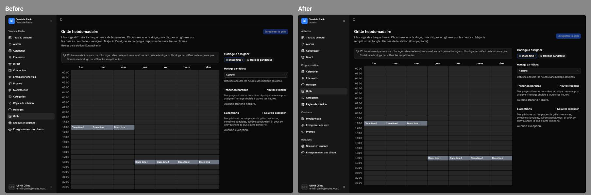
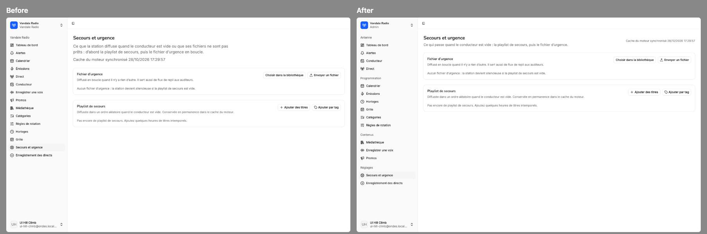
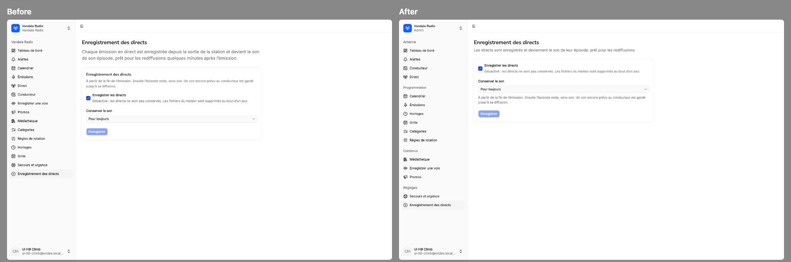
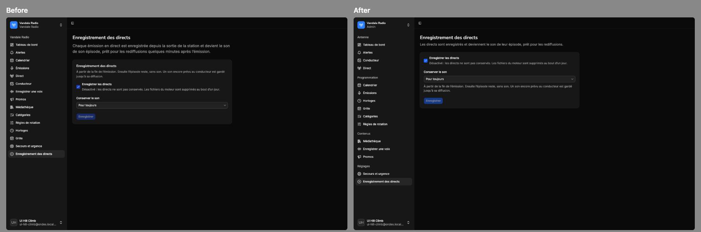
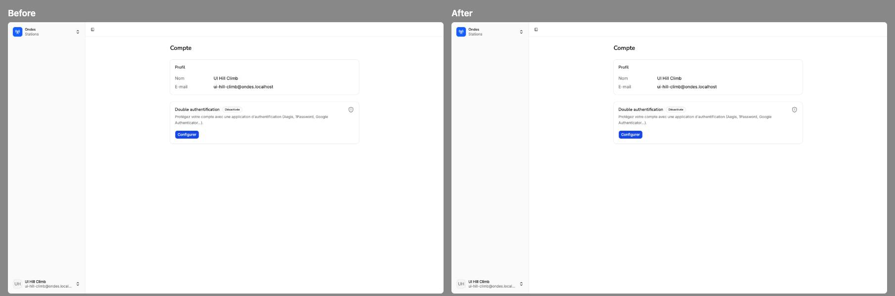

### Library
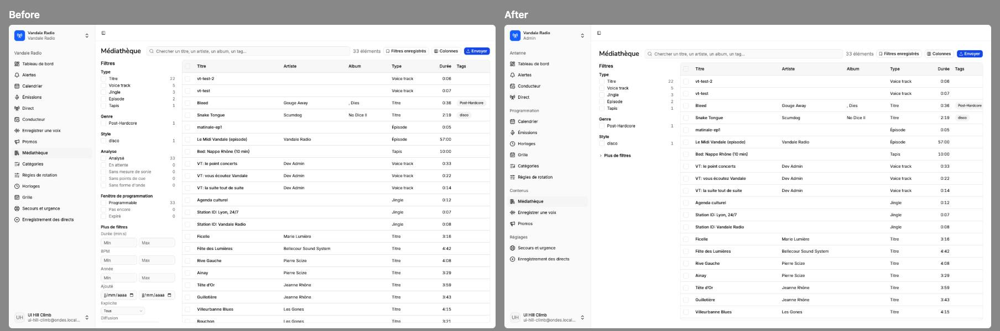
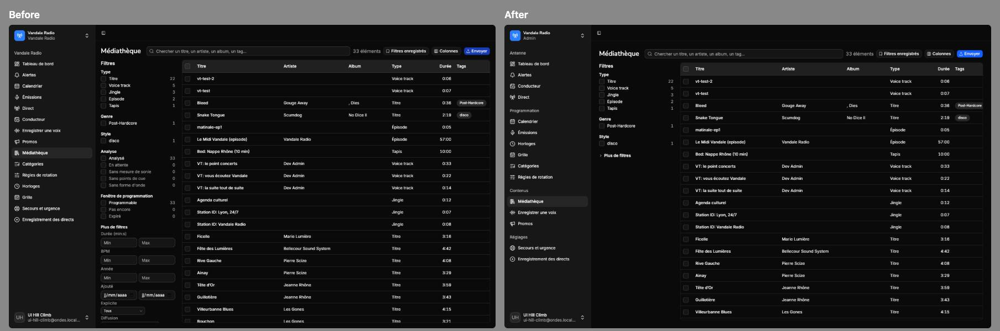
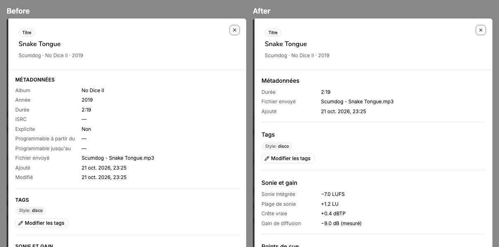
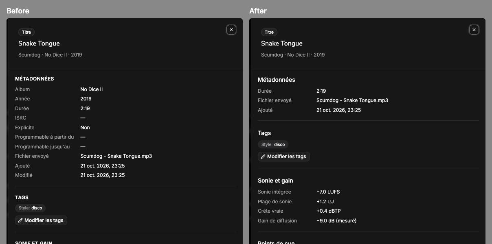

## Not done (worth a follow-up)
- The library's Tags column cuts long tags at the table's right edge.
- The 48px top bar holds only the sidebar toggle. It could show the station clock, but that
  needs the station's event stream above the shell, which it isn't today.
- The VT recorder and segue editor keep their own header rows (title + subtitle + status
  badges, no description); they use the shared `BackButton` but not `PageHeader`.
