# UI hill climb, pass 2: layout (2026-10-28)

Pass 1 ([../README.md](../README.md)) made the copy shorter and the headers consistent. This pass
is about layout: where things sit, what lines up with what, and how much empty space each page
leaves. Same method: every page on `main` and on the branch, light and dark, 1440×900, the same
dev data, shot back to back so the clock and the log match. Before on the left, after on the
right. Phone width (390px) was checked too.

## The big moves

### 1. The page header is the app's top bar
Before, every page had an empty 48px bar holding only the sidebar toggle, and then a header
inside the page. Now that bar is gone, and each page's header is the top bar. It is 64px tall,
exactly the height of the sidebar's station switcher, and has the same rule under it. The result
is one band across the whole window: station on the left, page title and actions on the right.
- **It's sticky.** Save stays in view at the bottom of a long rules list, category or clock.
- **Title and a one-line description** sit on the left and actions on the right. When space runs
  out, the description is cut short (the full text is in a tooltip) rather than wrapping.
- **Editors are titled with their object** ("Disco time !"), with "Modifier l'horloge" as the
  description. "Modifier l'horloge" alone never said which clock.
- **The sidebar toggle** shows only on phones. On a computer the sidebar folds from its rail or
  with Ctrl/Cmd+B, so titles line up with the content's left edge.
- **A slot between title and actions** holds a page's main control: the library's search, the
  calendar's period. On a phone it takes its own line.

### 2. Three widths, all left-aligned
- `full` for tools that use the window: calendar, log, grid, library, the editors, live.
- `list` (1024px) for lists and tables: alerts, shows, a show, categories, clocks, promos, the
  VT recorder. A row stretched to 1150px puts the actions far from the name they belong to.
- `form` (768px) for settings: safety, live recording, account.

The account page used to be centred while every other page was left-aligned. Now everything
shares one left edge. The bar itself always spans the window, with its actions anchored to the
right edge, so they sit in the same place on every page (a first version stopped them at the
content's width, where they looked like they were floating).

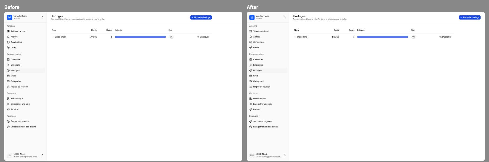
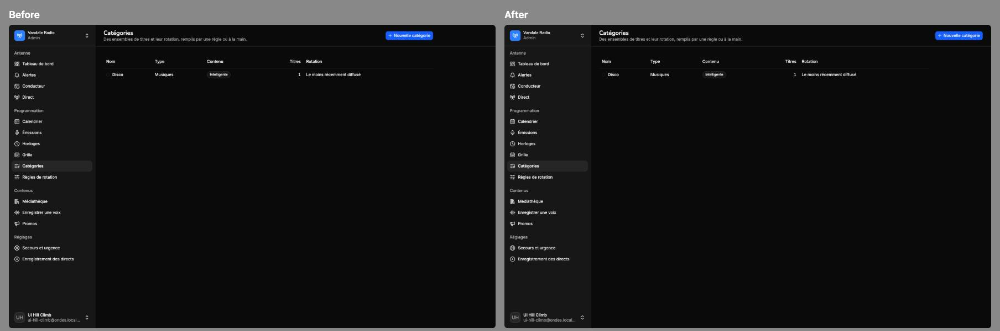

### 3. Controls next to what they control
- **Calendar:** every control is in the bar: the period (previous / today / next and the dates)
  on the left, the show filter and the view switch on the right. The week grid gets the window's
  full height. The view switch now looks like the app's tabs (a muted track with the current
  view raised); it was three separate buttons, one of them filled.
- **Log:** the timezone moved into the bar (as on the calendar). The day's state (tabs, draft
  badge, summary) and the day's actions (publish, marker, regenerate) now share one row, state on
  the left and actions on the right. The actions used to wrap onto a row of their own. The hour
  strip fits on one line (it used to wrap "23:00" alone). **Each empty hour is now one quiet
  dashed line** instead of a two-row card, so a mostly empty day reads as a short list.
- **Rotation rules:** Save and Cancel are in the bar. How the rules give way (the relaxation
  order) moved into the side column, above "Essayer un choix", in a card that follows you down
  the list. The main column is just the rules.
- **Alerts:** the status tabs and the type filter sit on one baseline, tabs on the left and
  filter on the right. The filter lost its "Type" label (its options say it) and is named for
  screen readers.
- **Grid:** "click or drag over the hours; Shift-click fills a rectangle" moved from the page
  description to under "Horloge à assigner", where you use it.
- **Promos:** the promos list comes first, under the bar's "Nouvelle promo"; the groups (setup)
  come second, with their own "Nouveau groupe".
- **Safety:** "cache synced" is now a footnote under the cards instead of a bar action, and the
  description fits.
- **VT recorder:** the record button is inside the mic card, under a divider: one block, mic
  then take. It used to float alone under the card.

### 4. Alignment and quiet
- **Show page:** each airing is three fixed columns: when, what (episode, status, or "choose an
  episode"), and the actions, right-aligned. "Envoyer l'audio" sits in the same place on every
  row, where it used to jump sideways. Row buttons are outline, not filled: eight filled blue
  buttons in a column competed with the page's real primary action. The show's artwork, name and
  hosts moved into the bar; the 96px artwork block is gone.
- **Dashboard:** the clock and what's playing share the left two thirds, with the show and the
  next fixed time on the right. Before, the clock had a full-width row to itself and left a
  ~700px gap beside it.
- **One control height per row:** toolbar selects were the `sm` size (24px, 10px text) next to
  28px buttons. Toolbars and bars now use the default size, so a row is one height.

## Before / after

### Top bar, widths
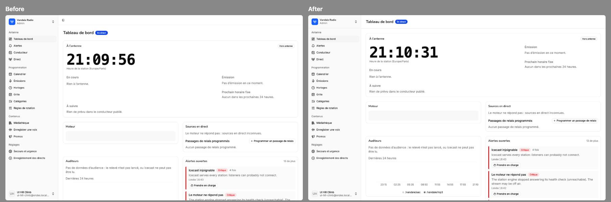
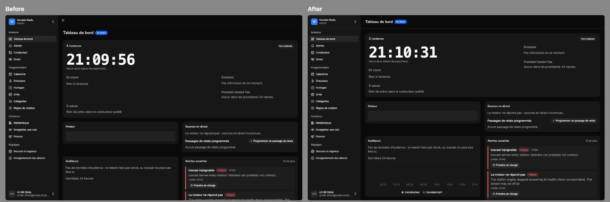
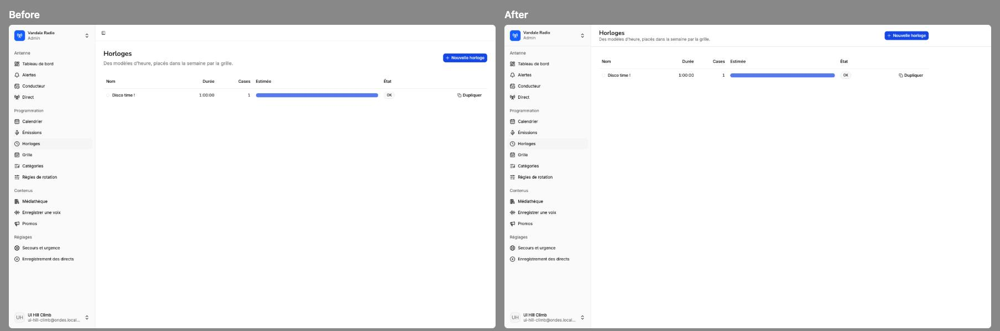
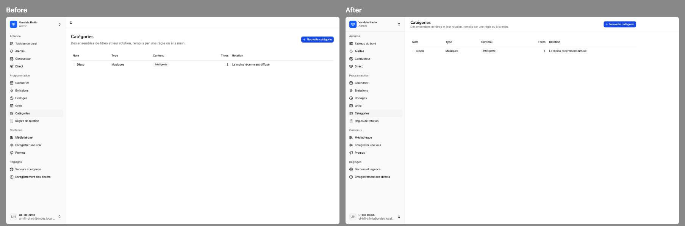
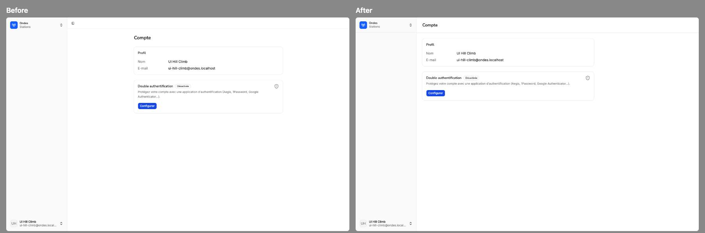
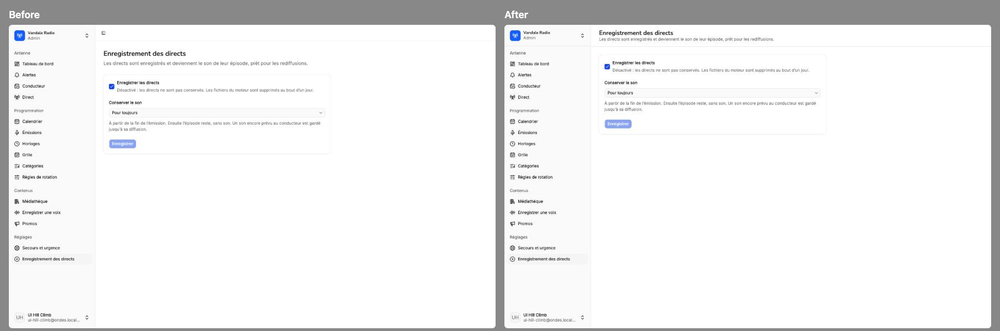

### Controls where they act
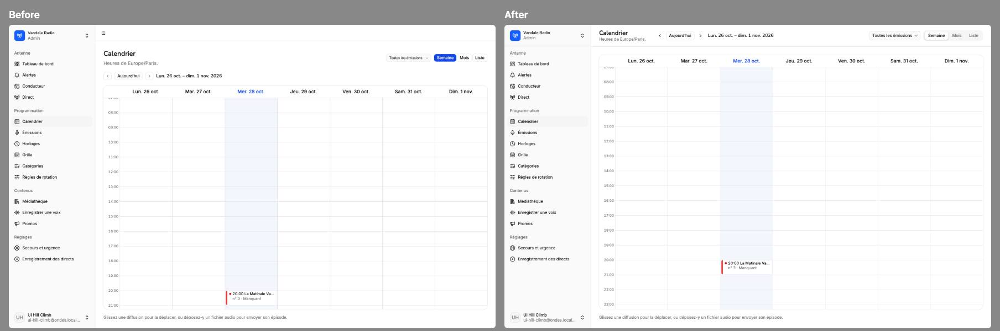
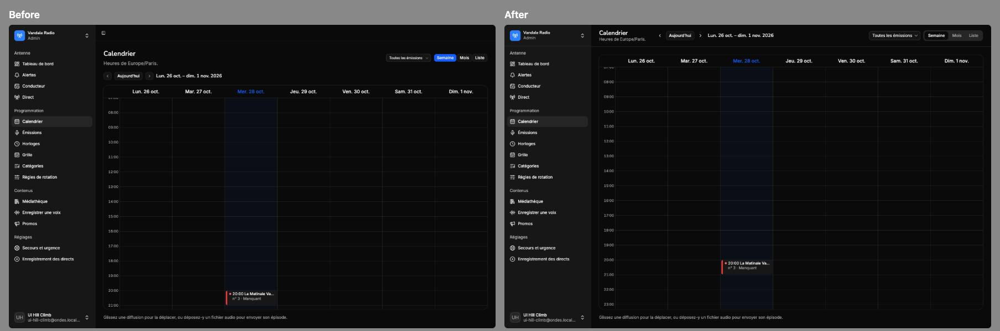
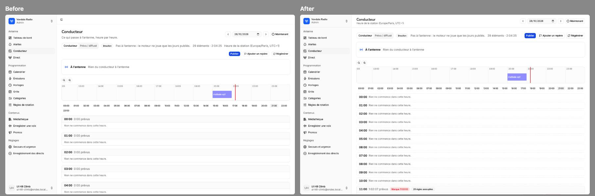
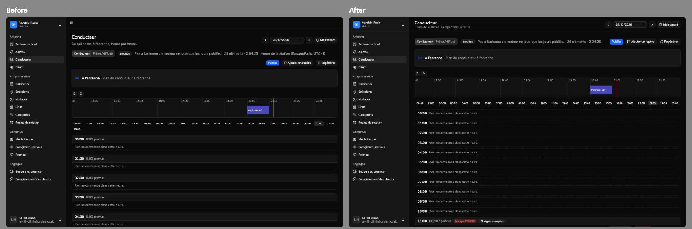
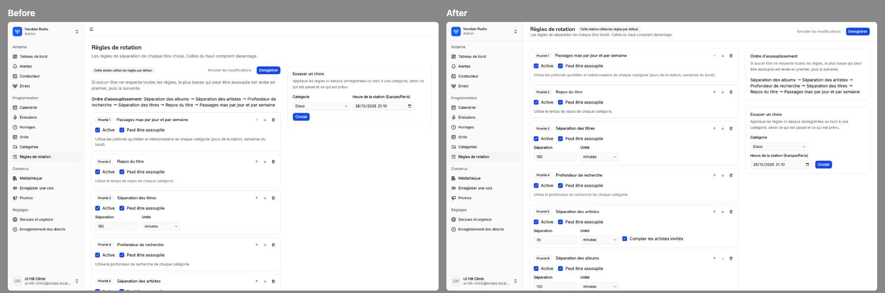
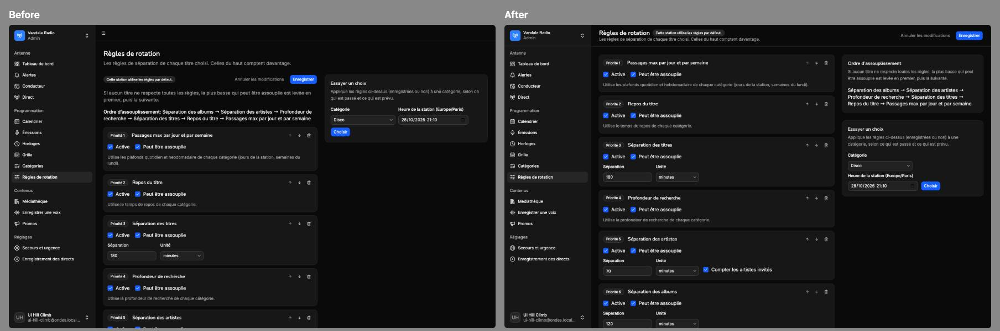
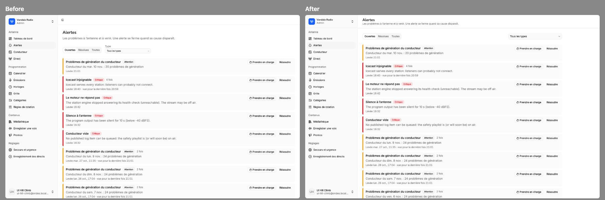
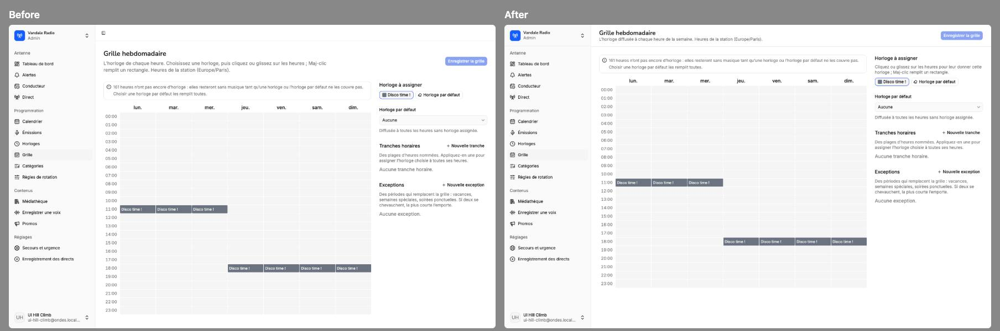
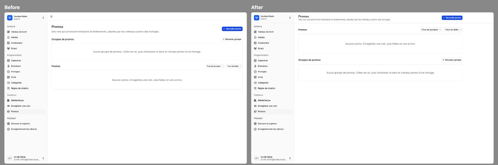
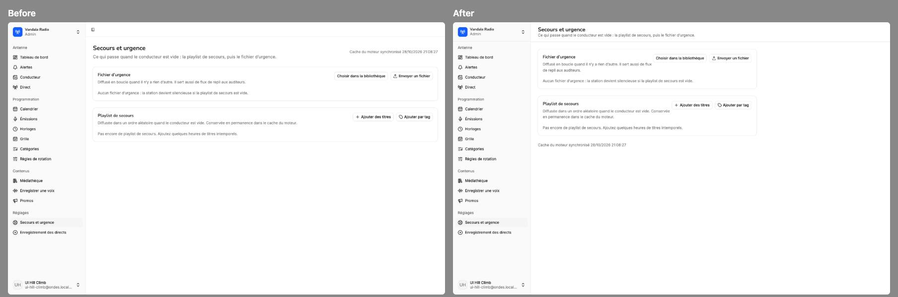
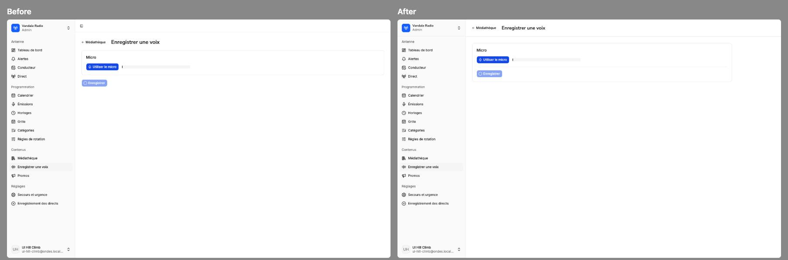
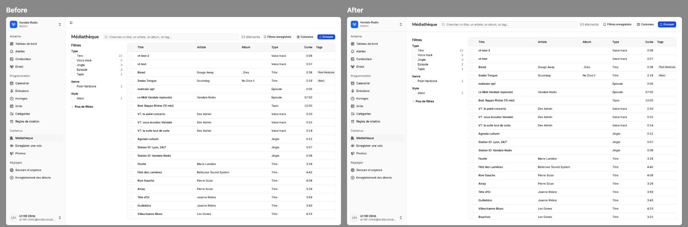

### Alignment
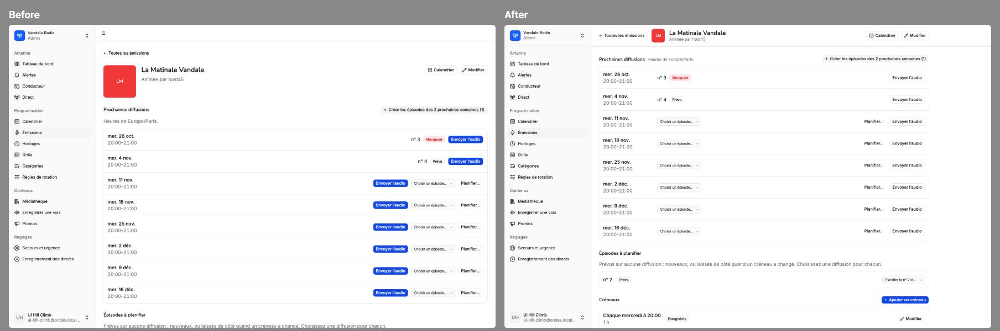
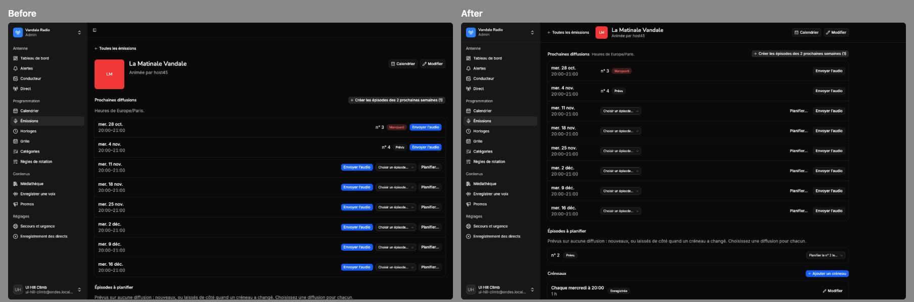
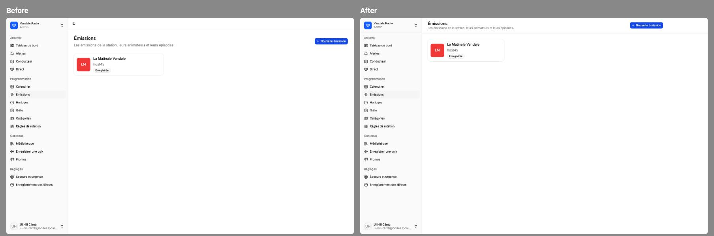
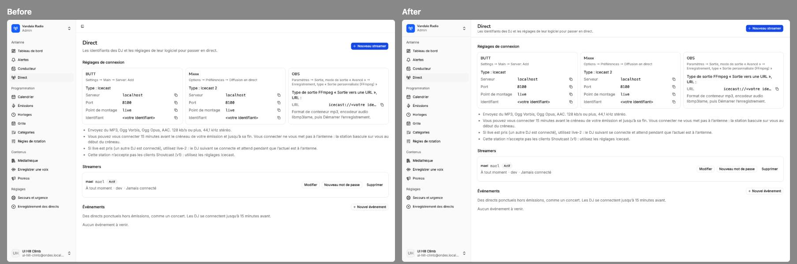
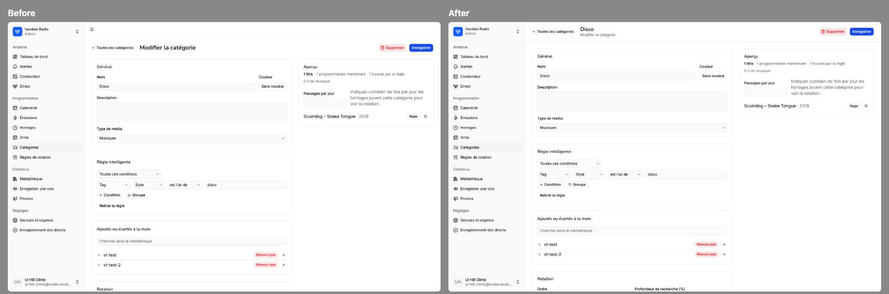
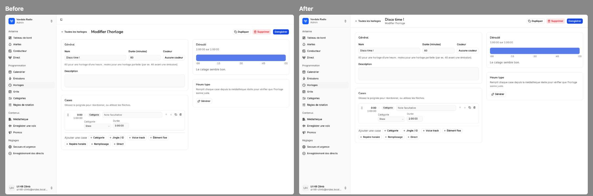

## Not done
- **Live:** the connection settings (three wide cards) and the long notes come before the
  streamers. For a DJ, the settings are the point of the page; for an admin, the streamers are.
  Splitting the page by role is a product decision, not a layout one.
- **Dashboard widgets** keep their own heights, so the grid can leave a gap under a short card.
- The engine status card shows its skeleton while the dev api answers 500 (no engine runs
  locally) and retries. That's the dev environment, not the layout.
